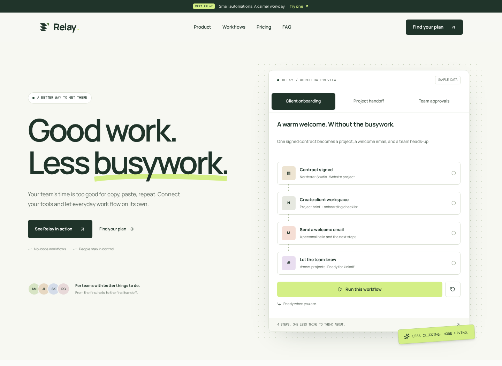
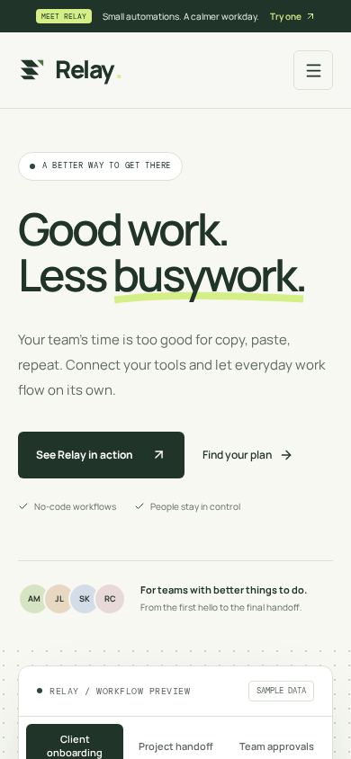
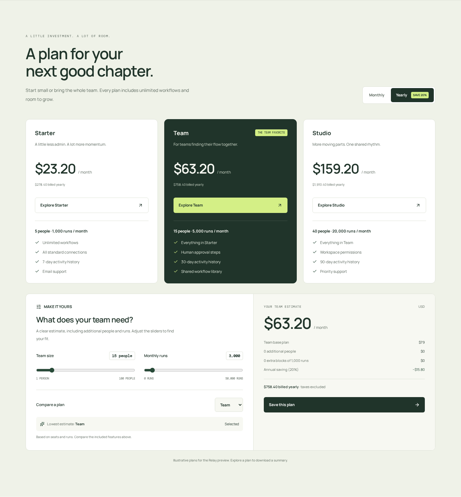
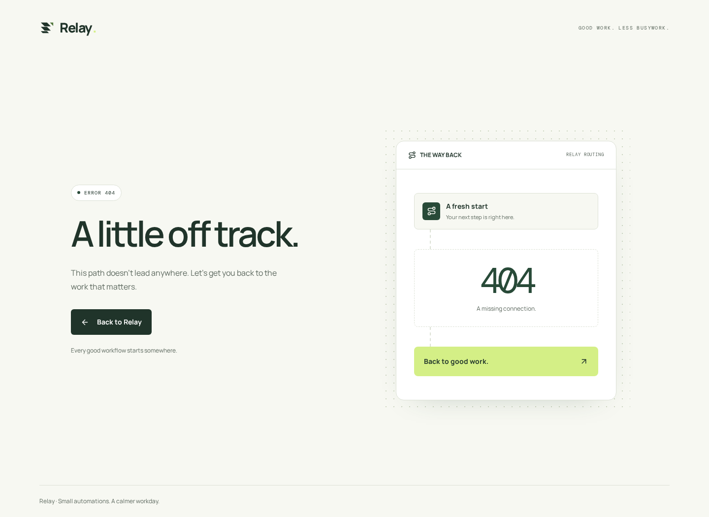

<div align="center">

# ↗ Relay

### Good work. Less busywork.

A Nuxt landing template for a team automation product.<br />
Built around a working demo, a transparent price, and a calmer workday.

[](https://nuxt.com/)
[](https://vuejs.org/)
[](https://tailwindcss.com/)
[](LICENSE)

**SaaS / 01** · Nuxt landing collection · Static output · English content

</div>



<details>
<summary>📱 A look at the mobile layout</summary>



</details>

## 🌿 A small product story

Relay imagines a simple automation tool for teams: a signed contract becomes a workspace, a welcome email, and a heads-up. A completed design arrives with a handoff brief. A request gets a human decision before anything else moves.

The landing page lets visitors try that idea. Its visual language is warm paper, dark green, lime accents, deliberate spacing, and a workflow panel that behaves like a product. All imagery is local or drawn in code; the fonts are self-hosted.

Relay is fictional. Names, scenarios, capacity limits, prices, and time-saving figures are sample content. Integrations are illustrative, and no third-party account is connected.

## 🔀 Follow a workflow

| Scenario              | What you can try                                                    |
| --------------------- | ------------------------------------------------------------------- |
| **Client onboarding** | Run four steps from signed contract to team notification.           |
| **Project handoff**   | Follow a design through its brief, implementation task, and update. |
| **Team approvals**    | Pause at a review step, then approve or send the request back.      |

Run, replay, reset, or switch scenarios. Pending steps stop on reset or tab change. Arrow keys, Home, and End navigate the tabs, and live status updates announce progress.

## 💸 Price the team's next chapter

Three plans share one calculation model. Adjust team size and monthly runs, inspect extra charges, and find the lowest estimate. Select any plan manually to compare its features and cost.

<details>
<summary>🧮 The plans and capacity calculator</summary>



</details>

| Plan    | Monthly base | People |   Runs | Extra person | Extra 1,000 runs |
| ------- | -----------: | -----: | -----: | -----------: | ---------------: |
| Starter |          $29 |      5 |  1,000 |           $5 |               $8 |
| Team    |          $79 |     15 |  5,000 |           $4 |               $6 |
| Studio  |         $199 |     40 | 20,000 |           $3 |               $4 |

Annual billing takes 20% off the full estimate. The page shows the monthly equivalent and total billed for a year. Calculations use integer USD cents; additional runs round up to blocks of 1,000. Taxes are excluded.

Choosing a plan opens a native dialog. Download a JSON brief containing capacity, billing cycle, features, and the breakdown. This is a local estimate, not a signup or payment flow.

## 🚀 Open the project

Use Node.js **24.11+ within the 24.x line** and npm. Nuxt is pinned to 4.5.2 to match that runtime; the lockfile records the dependency set.

```bash
npm ci
npm run dev
```

Development runs at `http://localhost:3000` by default.

```bash
npm run format:check
npm test
npm run typecheck
npm run generate
npx playwright install chromium --only-shell
npm run test:e2e
npm run preview
```

The static preview serves `.output/public` at `http://localhost:3000`. Stop development before using that port, or use `npm run preview -- --listen 3001`.

`npm run build` remains available for a Nuxt server build. Deployment uses **`npm run generate`** and the resulting static files.

Browser tests use the generated site on port 4173 and start their own temporary preview server. They cover font stability on cold loads and reloads, keyboard navigation, workflow approvals, plan downloads, and error-page recovery with and without JavaScript.

GitHub Actions runs formatting, pricing tests, type checking, static generation, and browser tests on pushes and pull requests. Failed browser runs retain a report, screenshots, and traces as an artifact.

## 🗂️ Where the pieces live

```text
app/
├── app.vue                     Landing entry and shared font setup
├── error.vue                   Relay's 404 and general error screen
├── assets/css/main.css          Palette, font families, minimal motion
├── composables/useLocalFonts.ts Persistent font faces and early preloads
├── components/
│   ├── BrandMark.vue            Relay's mark and wordmark
│   ├── SiteHeader.vue           Desktop and mobile navigation
│   ├── WorkflowDemo.vue         Scenarios and human approvals
│   └── PricingSection.vue       Plans, calculator, downloadable brief
├── data/
│   ├── site.ts                  Brand, navigation, features, tools, FAQ
│   ├── workflows.ts             Three example processes
│   └── plans.ts                 Plans and capacity rates
├── domain/pricing.ts            Pure, tested money calculations
└── pages/index.vue              Landing composition and metadata
server/routes/                  Build-time robots and sitemap generation
public/                         Favicon and editable/raster social artwork
docs/                           Customization guide and preview captures
tests/                          Pricing boundaries and annual billing
tests/e2e/                      Browser regressions and error-page recovery
scripts/capture-previews.mjs     Reproducible documentation screenshots
.github/workflows/ci.yml         Automated checks for each push and PR
```

Vue Composition API and TypeScript components handle the interface. Tailwind runs through its Vite plugin; Lucide supplies icons; Manrope and DM Mono are installed locally. There is no global state library, analytics script, remote image dependency, or database.

## 🎨 Make it yours

Start with [the customization guide](docs/CUSTOMIZATION.md). It maps content to files and explains approval checkpoints, pricing, logo replacement, artwork, and live-service integration points.

Colors live in one CSS `@theme` block. Features, tools, questions, workflows, and plans come from typed data. The hero, process story, and closing message remain explicit page composition.

## 🌍 From source to a public page

`vercel.json` configures static deployment:

| Setting          | Value              |
| ---------------- | ------------------ |
| Framework        | Nuxt               |
| Build command    | `npm run generate` |
| Output directory | `.output/public`   |
| Node.js          | 24.x               |

The default public origin is **`https://nuxt-saas-launch.vercel.app`**. On Vercel, `VERCEL_PROJECT_PRODUCTION_URL` supplies the actual production domain when available. Set **`NUXT_PUBLIC_SITE_URL`** before generating to override either value, for example when using your own domain. `.env.example` is a template, not an automatically loaded environment file. The resolved origin feeds canonical and social metadata, the sitemap, and crawler rules.

Generated routes are `/`, `/robots.txt`, and `/sitemap.xml`, plus a fully rendered `404.html`. Missing paths return the Relay error screen with HTTP 404, including when JavaScript is disabled. The page keeps a working home link and uses `noindex`. Other Nuxt errors use the same design with a general recovery message. `og.svg` is editable artwork; `og.png` is the social image. Rebuild after changing the URL or content. No deployment has been performed.

<details>
<summary>🧭 A way back: the Relay error page</summary>



</details>

## 🧩 Details that matter

- Core content is prerendered into HTML. JavaScript adds demo and pricing interactions.
- A skip link, focus styles, labeled controls, keyboard tabs, native FAQ disclosures, and a dialog support navigation. Press Tab from the top of the page to reveal **Skip to content**; Enter moves focus to the main content. The link is visually hidden during mouse browsing.
- Mobile layouts stack controls. Reduced-motion preferences disable nonessential animation.
- The two Latin WOFF2 fonts are preloaded and use optional display to avoid a late font swap on reload. Their faces stay in the document head during dev hydration. Slow first visits keep the fallback font for that navigation.
- Workflow headings and descriptions reserve space to keep surrounding content stable.
- Recommendations compare cost only; feature requirements need a human decision.
- Static deployment has no runtime server routes. Demos and downloads stay in the browser.
- Fonts and icons retain their package licenses. Tool names belong to their respective owners.

Dependency auditing still reports 11 high-severity findings through two transitive build-tool packages. The available critical fixes are applied; see [the dependency notes](docs/DEPENDENCIES.md) for the remaining advisories, overrides, and static-deployment scope.

## ✅ Before you publish

After changing the brand, content, or origin, run the checks under **Open the project** and preview the generated site. Keep these checks part of every landing in the collection:

| Check                     | Expected result                                                                                              |
| ------------------------- | ------------------------------------------------------------------------------------------------------------ |
| Cold load and reload      | Text stays in place as fonts load, in development and in the static preview.                                 |
| Small and large screens   | No horizontal overflow at 320, 390, and 1440 px; the menu and headings remain usable.                        |
| Public origin             | Canonical, social image URLs, `robots.txt`, and `sitemap.xml` point to the production domain.                |
| Keyboard and interactions | Navigation, workflow approval, billing controls, and plan downloads work; closing the dialog restores focus. |
| Product content           | Branding, contact details, prices, and concept labels match the intended product.                            |

See [the customization guide](docs/CUSTOMIZATION.md#before-release) for the release checklist.

To refresh the README images after changing the design, generate the site and start `npm run preview`, then run `npm run preview:images` in another terminal. Pass a different preview origin when needed: `npm run preview:images -- http://localhost:3001`. The capture script opens fresh pages and keeps the pricing section below the sticky header, so hidden controls and overlapping navigation do not enter its screenshot.

## 📄 License

[MIT](LICENSE) · Copyright © 2026 CodeSculptor
